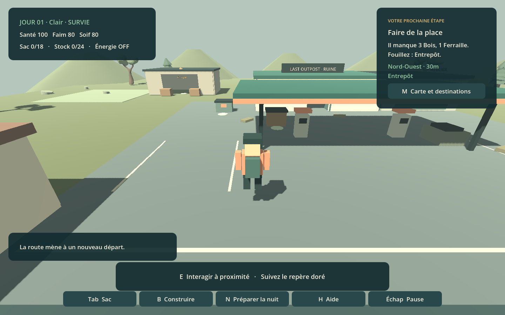

# Last Outpost

Jeu de survie et de restauration d'une station-service, en 3D stylisée sous Godot 4.7.2. Explorez, rapportez des matériaux, installez un récupérateur d'eau et un potager, échangez vos surplus et préparez les nuits. Cette version jouable construit la boucle du refuge ; sa durée de vie et son plaisir à long terme restent à éprouver avec des joueurs.



## Jouer simplement

**Dans ce dépôt : double-cliquer sur [Jouer.cmd](Jouer.cmd).** Le launcher propose le jeu Windows et la version navigateur, une aide et l'accès aux sauvegardes natives.

Pour déplacer le jeu : extraire **[LastOutpost-Complet-Windows-Web.zip](build/LastOutpost-Complet-Windows-Web.zip)** puis ouvrir `LastOutpostLauncher.exe`. Conserver ensemble le lanceur et les dossiers `windows` et `web`. Aucun éditeur Godot ni compte n'est nécessaire. La version locale n'est pas signée numériquement.

La version navigateur fonctionne localement sur ordinateur compatible WebGL 2. **Garder le launcher ouvert** pendant la partie : il fournit le serveur local, puis l'arrête à sa fermeture. Le jeu n'est pas encore hébergé publiquement. Les sauvegardes du navigateur et de Windows sont distinctes. L'exécutable direct reste disponible dans `build/windows/LastOutpost.exe` et dans [l'archive Windows seule](build/LastOutpost-Windows-x64.zip).

## Votre première partie

Choisir **Découverte** pour des besoins plus doux et aucune attaque, ou **Survie** pour gérer le bruit du générateur et la défense. Le temps avance seulement après confirmation de la prochaine nuit.

1. Suivre le repère doré jusqu'à l'entrepôt ; fouiller avec **E**.
2. Rapporter bois et ferraille au stock ; **E** dépose le sac et ouvre l'atelier.
3. Installer l'étagère, puis suivre l'objectif vers le générateur, l'eau, le potager et le comptoir.
4. Reprendre des provisions au stock, consulter les prévisions et préparer la nuit.

La carte permet de suivre une autre destination. Le marchand vient un jour sur deux après construction du comptoir ; ses échanges sont limités par visite. Les matériaux des lieux sont finis, mais l'eau, la nourriture et le troc permettent de poursuivre après leur épuisement.

| Commande | Action |
| --- | --- |
| ZQSD / WASD / flèches | Se déplacer |
| Maj / Espace | Courir / sauter |
| Clic droit + souris / molette | Orienter / rapprocher la caméra |
| E | Fouiller, déposer au stock, utiliser le générateur |
| Tab / M / H | Sac et réserves / carte / aide |
| B, R, E, Échap | Préparer, tourner, placer ou annuler une barricade |
| 1 / 2 | Manger / boire depuis le sac |
| N | Préparer la nuit, puis confirmer dans le panneau |
| Échap | Fermer un panneau / pause |
| K / L | Sauvegarder / charger |

Les menus proposent volume, grands textes et navigation au clavier. La progression est sauvegardée au début, après une nuit et au retour à l'accueil ; **K** permet de sauvegarder pendant l'exploration. La sauvegarde native se trouve dans le dossier utilisateur Godot (`last_outpost_station_v1.json`, contenu v2, copie `.bak`). Une défaite préserve la dernière sauvegarde vivante.

## Développer et vérifier

`godot/` contient une copie locale de l'éditeur, ignorée par Git. Un autre emplacement est possible avec `-GodotPath`. Les modèles d'export doivent correspondre à Godot 4.7.2.

```powershell
& .\godot\Godot_v4.7.2-stable_win64_console.exe --path .
powershell -NoProfile -File scripts/validate.ps1
powershell -NoProfile -File scripts/agent-check-selftest.ps1
powershell -NoProfile -File tests/launcher.ps1
powershell -NoProfile -File scripts/export-web.ps1
powershell -NoProfile -File scripts/export-windows.ps1
powershell -NoProfile -File scripts/build-launcher.ps1 -Package
python tests/web_smoke.py --steps tests/web_journey.json --output build/web-smoke
```

Créer l'archive complète **après les deux exports de la même révision**. Le test navigateur utilise Chrome et le paquet Python Playwright déjà disponibles sur cette machine ; il ne les installe pas. `build/` et `godot/` sont ignorés par Git. Les commandes de l'éditeur sont également dans `.vscode/tasks.json`.

## Conception et écosystème IA

- [Conception](docs/GAME_DESIGN.md), [roadmap](docs/ROADMAP.md), [architecture](docs/ARCHITECTURE.md), [tests et limites](docs/TESTING.md), [changements](docs/CHANGELOG.md).
- [Point de reprise](docs/agent/PROJECT.md), [opérations agentiques](docs/agent/OPERATIONS.md), [bugs et preuves](docs/agent/BUGS.json), [mises à jour](docs/agent/UPDATES.md), [base de connaissances](docs/knowledge/INDEX.md).
- Trois skills de projet dans `.agents/skills/` : développement, non-régression et livraison. `agent-check.ps1` vérifie leur cohérence et les preuves du suivi. Ces routines s'exécutent pendant les sessions de travail ; aucun agent permanent n'est installé.

L'ancien prototype de colonie reste dans `scenes/main.tscn` (ouvrir puis **F6** dans Godot). Il est distinct du jeu principal.

Les arbres GLB proviennent du pack **Low poly trees** de Polybuild, sous licence MIT. Les autres éléments 3D et sons sont générés dans le projet. Sources et licences : [ASSETS.md](docs/ASSETS.md), `assets/third_party/polybuild_trees/LICENSE.md` et `licenses/` ; notices incluses dans les exports.
