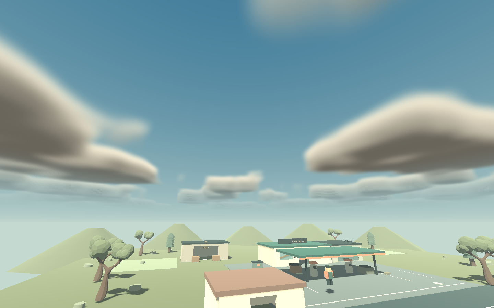

# Assets et licences

## Ciel et nuages

`game/world/outpost_sky.gdshader` crée un ciel procédural original : dégradé atmosphérique, soleil et couche nuageuse entre 80 et 125 unités de hauteur. Le shader intègre une densité 3D en 20 échantillons maximum par rayon, avec extinction, éclairage approché et vent. `cloud_noise.tres` produit le bruit localement. La couverture et la couleur suivent Clair/Pluie/Orage.

Ce rendu conserve Compatibility pour Windows et WebGL 2. Les FogVolumes natifs exigent Forward+ ; le shader Sky évite de changer de renderer. Le calcul est limité aux pixels de ciel visibles, avec arrêt anticipé dans les masses opaques et cubemap d'éclairage simplifiée. Il ne projette pas d'ombres de nuages sur le terrain. Les performances sur machines faibles restent à mesurer.

Références : [Sky shaders Godot 4.7](https://docs.godotengine.org/en/4.7/tutorials/shaders/shader_reference/sky_shader.html), [architecture du rendu](https://docs.godotengine.org/en/4.7/engine_details/architecture/internal_rendering_architecture.html), consultées le 29 septembre 2026.

## Décor

La boutique, le garage, les pompes, la cuve, les étagères, les barricades, le personnage et le décor proche sont assemblés en code à partir de formes et matériaux Godot dans `game/world/station_world.gd` et `game/player/third_person_controller.gd`. Ce choix fournit un langage visuel modulaire et évite un pipeline Blender pour cette première tranche.

Les quatre fichiers `assets/third_party/polybuild_trees/tree*.glb` viennent du pack [Low poly trees](https://store.godotengine.org/asset/polybuild/low-poly-trees/) de **Polybuild**, sous licence MIT selon la fiche consultée lors de leur import. Le texte de licence et les crédits d'origine sont conservés dans `assets/third_party/polybuild_trees/LICENSE.md` et copiés dans les exports. Les licences et mentions du moteur Godot sont dans `licenses/` et dans les exports.

Les palettes des arbres sont adaptées en mémoire pour harmoniser le décor. Les véhicules abandonnés, collines, mobilier, récupérateur, potager et comptoir sont également des assemblages originaux de primitives. Le personnage dispose d'une animation procédurale de marche. Le vent, le générateur et les signaux d'action sont synthétisés par `game/audio/soundscape.gd`, sans fichier audio externe.

Avant tout autre import, conserver auteur, source, URL et licence à côté de l'asset. Ne considérer ni le style ni la disponibilité sur une bibliothèque comme une autorisation de redistribution.
